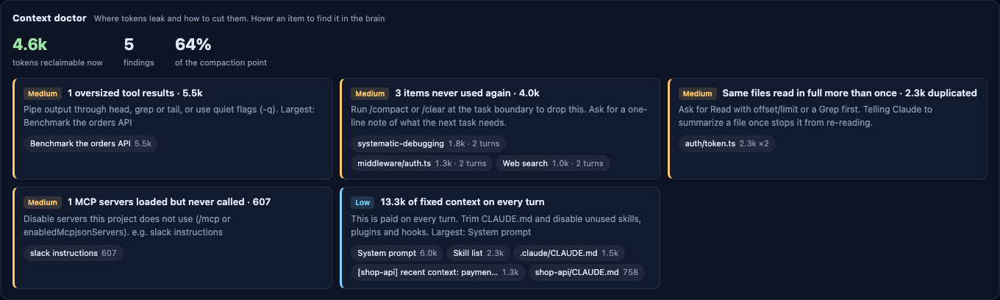
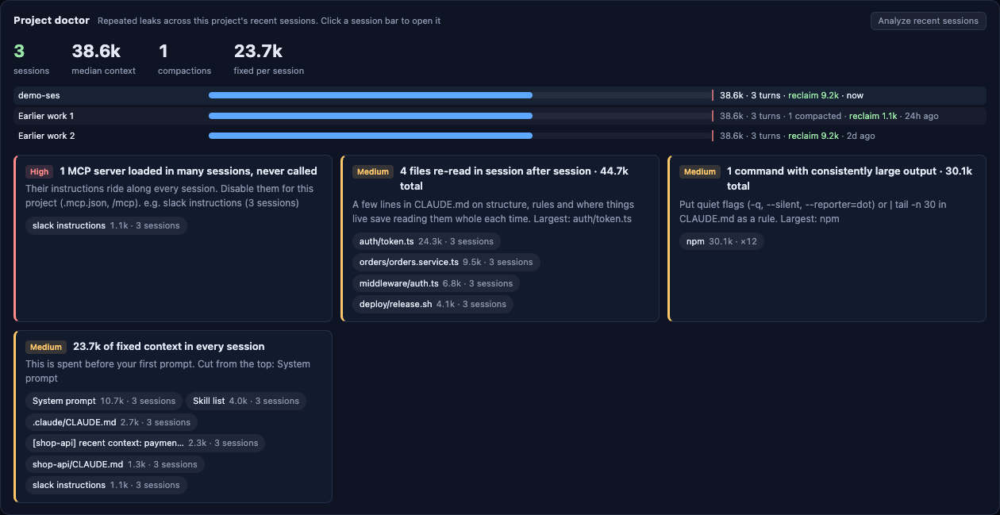
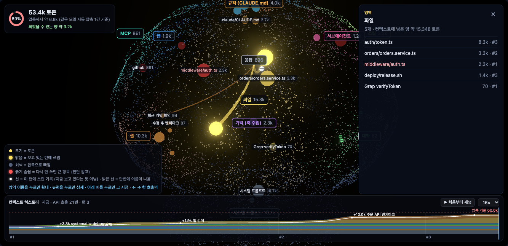
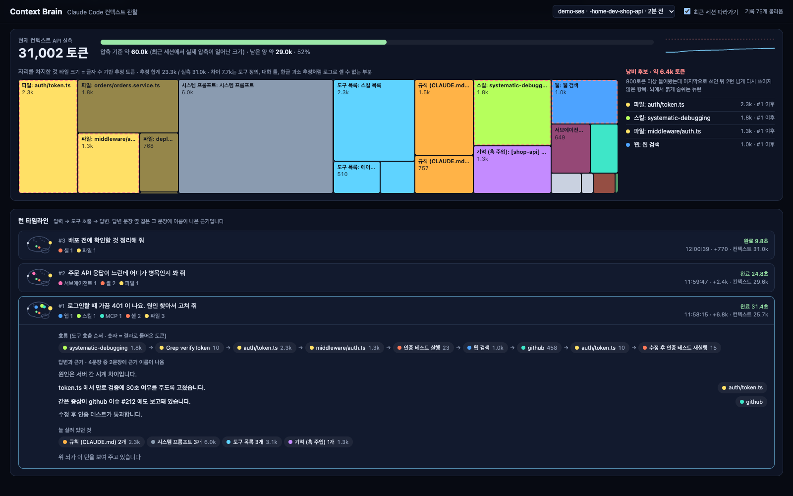

# Context Brain

**Claude Code 세션의 컨텍스트를 3D 뇌로 보여 주는 로컬 뷰어.** 컨텍스트 종류마다 뇌 영역을 하나씩 두고, 컨텍스트에 들어온 항목(읽은 파일, 셸 출력, 규칙, 스킬…)을 뉴런으로 그립니다. 뇌만 보고도 세 가지가 읽히도록 만들었습니다.

| 질문 | 뇌에서 보이는 것 |
|---|---|
| 무엇이 컨텍스트를 차지하고 있나 | 영역 배지의 토큰 합계, 뉴런 크기, 큰 항목의 이름표 |
| 이번 답변은 무엇을 보고 나왔나 | 항목에서 응답 영역으로 이어진 빛줄기 (굵기 = 들어온 토큰). 답변에 이름이 나온 근거는 흰 입자 |
| 무엇이 자리만 차지하고 있나 | 붉게 숨쉬는 뉴런 (낭비 후보) |
| 세션이 어떻게 흘러왔나 | 재생 막대로 처음부터 다시 보기 |
| 무엇을 고치면 되나 | 컨텍스트 진단: 새는 곳마다 크기와 고칠 방법. 브라우저 · 터미널 · Claude Code 상태줄 |

**[▶ 웹 데모](https://context-brain.pages.dev/?lang=ko)** (설치 없이 예시 세션 재생) · [English](README.md)


## 빠른 시작

```bash
npx github:workdd/context-brain
```

브라우저가 열리고 가장 최근에 수정된 Claude Code 세션을 실시간으로 따라갑니다. 다른 세션은 위쪽 목록에서 고릅니다. 설정은 필요 없습니다. Claude Code가 이미 남기는 세션 로그를 읽기만 합니다.

| 명령 | 동작 |
|---|---|
| `npx github:workdd/context-brain` | 뷰어 실행 (http://localhost:7788) 후 브라우저 열기 |
| `... demo` | 가짜 세션으로 실행 (Claude Code 없이 확인) |
| `... export latest --redact -o 세션.html` | 세션을 HTML 파일 하나로 저장 |
| `... doctor [세션\|latest]` | 진단과 조치를 터미널에 출력 (`--json`) |
| `... doctor --project` | 프로젝트의 최근 세션들에서 반복되는 낭비 |
| `... statusline` | Claude Code 상태줄용 한 줄 |
| `... calibrate` | 내 세션 실측 사용량으로 토큰 추정 계수를 맞춰 `~/.config/context-brain/tokens.json` 에 저장 |
| `--port <번호>` | 포트 지정. 차 있으면 다음 번호 |
| `--no-open` | 브라우저를 열지 않음 |

- 저장소를 받아 쓸 때는 `npm install && npm start`
- Node.js 18 이상이 필요합니다. 런타임 의존성은 없습니다 (jest는 테스트용)
- three.js는 브라우저에서 CDN(jsdelivr, `three@0.160.0`)으로 불러옵니다
- 화면 언어는 브라우저 언어를 따릅니다. 상단 버튼으로 한국어와 영어를 바꿉니다

## 컨텍스트 진단



| 진단 | 권하는 조치 |
|---|---|
| 같은 파일을 여러 번 통째로 읽음 | offset · limit 로 필요한 줄만 읽기, Grep 먼저, 한 번 요약해 두기 |
| 한 번에 큰 도구 결과 (결과 하나가 4k 토큰 이상) | head · grep · tail 로 줄이기, 조용한 옵션 |
| 들어와서 다시 안 쓰인 항목 (800토큰 이상, 2턴 넘게 안 씀) | 작업이 바뀌는 지점에서 `/compact` 나 `/clear` |
| 안내만 실리고 한 번도 안 부른 MCP 서버 | 이 프로젝트에서 서버 끄기 |
| 불러 놓고 안 쓴 도구 스키마 | 쓸 도구 이름을 지시에 적기 |
| 반복된 도구 실패 | 원인(권한 · 경로 · 명령)을 먼저 알려 주기 |
| 늘 실려 있는 고정 비용 (규칙 · 스킬 목록 · 훅) | CLAUDE.md 줄이기, 안 쓰는 스킬 · 플러그인 끄기 |
| 자동 압축 직전 | 남길 내용을 적어 지금 `/compact` |

"지금 되찾을 수 있는 양"은 조치하면 실제로 컨텍스트에서 빠지는 양만 셉니다. 아직 남아 있는 안 쓰인 항목, 안 부른 MCP 안내, 안 쓴 스키마입니다.

터미널에서는 `npx github:workdd/context-brain doctor` (스크립트용은 `--json`)로 같은 진단을 봅니다.

## 프로젝트 진단



세션 하나에서 보인 것은 우연일 수 있습니다. 프로젝트 진단은 같은 프로젝트의 최근 세션 20개를 읽고 반복되는 것만 남깁니다.

| 진단 | 확실한 신호인 이유 |
|---|---|
| 여러 세션에 실렸지만 한 번도 안 부른 MCP 서버 | 세션마다 안내 비용만 냅니다. 이 프로젝트에서 꺼도 됩니다 |
| 세션마다 다시 읽는 파일 | 요점을 CLAUDE.md 에 몇 줄 적어 두면 매번 통째로 읽지 않습니다 |
| 출력이 늘 큰 명령 | 프로그램(`npm`, `gh`, `pytest` …) 단위로 묶습니다. `cat`, `sed` 같은 파일 읽기는 뺍니다 |
| 세션마다 실리는 고정 비용 | 첫 입력 전에 이미 쓴 양입니다. 시스템 프롬프트, 스킬 목록, CLAUDE.md, 훅 |

뇌 아래 "최근 세션 분석" 버튼이나 터미널의 `doctor --project` 로 봅니다. 세션 막대를 누르면 그 세션으로 이동합니다.

### Claude Code 상태줄

`~/.claude/settings.json` 에 넣으면 모든 세션의 상태줄에 되찾을 양이 따라붙습니다.

```json
{ "statusLine": { "type": "command", "command": "npx -y github:workdd/context-brain statusline" } }
```

```text
🧠 ctx 232k (29%) · 되찾을 양 16k · 진단 높음 2
```

상태줄 입력의 `transcript_path` 를 읽고, 압축 기준은 10분 동안 캐시합니다. 더 빠르게 쓰려면 저장소를 받아 `node /경로/context-brain/bin/context-brain.js statusline` 을 지정하세요.

## 뇌 읽는 법

### 영역

| 영역 | 뇌 위치 | 무엇이 들어오나 |
|---|---|---|
| 응답 | 앞쪽 | Claude의 생각과 답변. 모든 빛줄기가 모이는 곳 |
| 규칙 (CLAUDE.md) | 앞쪽 위 | 실린 CLAUDE.md 파일마다 뉴런 하나 |
| 도구 목록 | 꼭대기 | 스킬 목록, 에이전트 목록, MCP 안내, 지연 로드한 도구 스키마 |
| 서브에이전트 · 웹 | 앞쪽 좌우 | Agent 호출(종류별), WebSearch · WebFetch(호스트별) |
| 스킬 · MCP | 뒤쪽 좌우 | Skill 호출과 스킬 본문, `mcp__서버__도구` 호출(서버별) |
| 대화 · 셸 | 옆 아래 | 사용자 입력과 압축 요약, Bash 명령 (명령 1회 = 뉴런 1개, 이름은 명령 설명) |
| 파일 | 뒤쪽 | Read, Edit, Write, Grep, Glob |
| 기억 (훅 주입) | 안쪽 | SessionStart 훅 등이 넣은 추가 컨텍스트 |
| 시스템 프롬프트 | 아래 뒤 | 시스템 프롬프트, 환경, 날짜, 모델 정보 |

뇌 표면은 항목이 있는 영역만 그 영역 색으로 옅게 칠해집니다. 영역 배지에는 이름과 지금 컨텍스트에 남은 토큰 합계가 나옵니다.

### 뉴런과 빛

| 보이는 것 | 뜻 |
|---|---|
| 뉴런 크기 | 그 항목이 차지한 토큰 수 (추정) |
| 밝은 뉴런 | 보고 있는 턴에 쓰임. 그 전 두 턴에 쓰인 것은 중간 밝기, 오래된 것은 어둡게 |
| 회색 뉴런 | 압축으로 컨텍스트에서 빠짐 |
| 붉게 숨쉬는 뉴런 | 낭비 후보. 800토큰 이상 들어왔는데 마지막으로 쓰인 뒤 2턴 넘게 다시 쓰이지 않음 |
| 이름표 | 토큰이 큰 상위 8개와 보고 있는 턴의 항목(최대 12개). 겹치면 우선순위가 낮은 쪽을 숨김 |
| 빛줄기 | 보고 있는 턴에 쓰인 항목 → 응답. **굵기 = 결과로 들어온 토큰**. 입자가 계속 흐름 |
| 흰 입자 | 답변 문장에 그 항목 이름이 그대로 나옴 (근거) |
| 순간 반짝임 | 실시간으로 도구 호출(영역 색)과 결과(흰색)가 오갈 때 |
| 전체가 붉게 번쩍임 | 압축이 일어남 |

### 조작

| 조작 | 동작 |
|---|---|
| 영역 배지 클릭 | 카메라가 그 영역으로 다가가고, 오른쪽에 그 영역 항목 목록이 뜸 |
| 뉴런 클릭 | 상세 패널: 실행한 명령이나 수정 내용 전체, 결과 앞부분, 사용 이력, 쓰인 턴 |
| ◀ ▶ (또는 `[` `]` 키) | 보고 있는 턴을 바꿈. 뇌의 밝기와 빛줄기가 그 턴 기준으로 바뀜 |
| 옆 · 위 · 앞 | 시점 이동. 드래그로 돌리고 휠로 확대 |
| 회전 | 자동 회전 켜기/끄기 (기본은 끔) |
| 크게 | 화면 전체로 키움 (Esc로 복귀) |
| 재생 막대 | 세션을 처음부터 다시 흘려 봄. 4 · 16 · 64배속, 막대를 끌면 그 시점으로 이동, Space로 재생과 멈춤 |

왼쪽 위 링은 압축 기준 대비 현재 컨텍스트 크기입니다. 압축 기준은 최근 세션에서 실제로 자동 압축이 일어난 직전 크기 중 최댓값입니다.



## 공유용 HTML

상단의 "공유용 HTML" 버튼이나 `export` 명령은 세션을 서버 없이 열리는 HTML 파일 하나로 저장합니다. 파일을 열면 처음부터 자동 재생됩니다.

- 홈 경로는 늘 `~`로 바꿉니다
- "내용 가리기"(`--redact`)는 결과 미리보기, 실행한 명령, 입력 문장, 답변 본문을 뺍니다. 근거 표시는 파서가 남긴 언급 기록으로 유지됩니다
- 가리지 않은 파일에는 읽은 파일 내용 앞부분과 명령이 들어 있습니다. 남에게 줄 때는 가린 쪽을 쓰세요

## 뇌 아래 패널



| 패널 | 내용 |
|---|---|
| 컨텍스트 예산 | 현재 컨텍스트(API 실측), 압축 기준 게이지, 크기 변화 그래프, 항목별 면적 지도, 낭비 후보 목록 |
| 턴 타임라인 | 턴마다 작은 뇌 썸네일, 도구 호출 흐름(실패는 빨간 테두리), 답변 문장별 근거 칩, 늘 실려 있던 컨텍스트. "이 턴을 뇌에서 보기"로 위 뇌를 그 턴으로 바꿈 |

목록 위에 마우스를 올리면 뇌에서 해당 뉴런이 잠깐 밝아집니다.

## 동작 방식

```
~/.claude/projects/<프로젝트>/<세션>.jsonl   Claude Code가 쓰는 세션 로그
        │  0.4초마다 새 줄만 읽음 (lib/tail.js)
        ▼
파서 (lib/parse.js)
  · attachment(instructions, skill_listing …)  → 로드
  · assistant tool_use                          → 사용
  · user tool_result (tool_use_id로 짝 맞춤)     → 결과
  · assistant text                              → 답변 본문 + 언급
  · usage                                       → 컨텍스트 크기 (실측)
  · system turn_duration / compact_boundary     → 턴 종료 / 압축
        │  Server-Sent Events (server.js, 127.0.0.1:7788)
        ▼
브라우저
  · public/model.js  면적 지도 배치, 문장 분리, 근거 연결, 낭비 판정
  · public/app.js    3D 뇌 (three.js), 예산, 타임라인, 상세
```

- Claude Code 설정이나 훅을 건드리지 않습니다. 로그 파일을 읽기만 합니다
- 서버는 `127.0.0.1`에만 열립니다. `~/.claude/projects` 밖의 파일은 요청해도 404를 돌려줍니다
- 서브에이전트 내부 작업(사이드체인)과 claude-mem 관찰 세션은 그리지 않습니다

## 숫자의 정확도

로그에는 API 호출마다 전체 컨텍스트 크기만 남고 항목별 토큰은 없습니다. 그래서 항목별 토큰은 글자로 추정하되, 계수는 실측 크기에 맞춥니다.

- 두 API 호출 사이에 도구 결과가 딱 하나 들어온 구간은 실측 컨텍스트 증가량이 곧 그 결과의 실제 토큰입니다. 이를 글자 수로 회귀해 계수를 얻습니다.
- 실제 세션 455개에서 뽑은 표본 235개로 맞췄습니다: **ASCII 2.25자당 1토큰, 한글 1글자당 1.45토큰**, 그 밖 문자 1글자당 2.43토큰, 도구 결과마다 34토큰.
- 이미지는 크기로 셉니다. 가로 × 세로 / 750 이 스크린샷 19장에서 실측과 3% 안으로 맞았습니다.

| 추정 방식 | 결과별 중앙 오차 | 추정 합계 / 실측 |
|---|---|---|
| 글자 수 / 4 (흔한 어림) | 53% | 0.42 |
| 맞춘 계수 | **6%** (나머지 절반 세션 검증 9%) | **1.00** (검증 0.95) |

세션 전체로 보면 항목 추정 합계가 실측 컨텍스트의 0.8~1.0배입니다. 나머지는 도구 정의, 대화 틀처럼 로그에 남지 않는 부분입니다. 계수는 한 사람의 세션, 한 모델에서 맞춘 값이므로 `calibrate` 로 자기 로그에 다시 맞추세요.

## 읽을 때 주의

- **빛과 근거는 attention이 아닙니다.** 실제로 일어난 사용 기록(도구 호출, 결과, 답변 본문의 이름 일치)입니다. 이름을 말하지 않고 내용만 쓴 문장은 근거가 없는 것처럼 보입니다.
- **뉴런 토큰은 추정치입니다.** 실측 사용량에 맞춘 계수로 셉니다 (위 절 참고). 링과 "현재 컨텍스트"만 API 실측값입니다.
- **압축 기준은 관측값입니다.** 모델이나 설정이 다른 세션의 압축 크기가 섞일 수 있습니다.
- **낭비 후보는 제안입니다.** 다시 쓰이지 않았다는 사실만 봅니다. 규칙처럼 조용히 참고되는 내용은 대상에서 뺐습니다.
- **로그 형식은 공개 규격이 아닙니다.** Claude Code 버전이 바뀌면 일부 항목이 안 잡힐 수 있습니다. 파서는 모르는 항목을 건너뜁니다.

## 개발

```bash
npm test             # jest, lib/ 와 public/model.js 커버리지 포함
npm run demo         # 가짜 세션이 한 단계씩 진행됨
npm run build:web    # 웹 데모 web/index.html 생성
```

| 파일 | 역할 |
|---|---|
| `lib/parse.js` | 로그 한 줄 → 이벤트 변환 (영역 분류, 토큰 추정, 상세 미리보기, 답변 본문) |
| `lib/tail.js` | 커지는 파일 따라 읽기 (덜 쓴 줄은 다음 읽기로 넘김) |
| `lib/sessions.js` | 세션 목록, 경로 검사, 관측된 압축 기준 |
| `server.js` | 정적 파일 + `/api/sessions` + `/api/limits` + `/api/stream` (SSE) + `/api/export` |
| `lib/tokens.js` | 토큰 추정 (맞춘 계수, 이미지 크기) |
| `lib/calibrate.js` | 실측 사용량으로 계수 맞추기 |
| `lib/project.js` | 프로젝트의 최근 세션 파싱 (수정 시각으로 캐시) |
| `lib/export.js` | 세션을 HTML 파일 하나로 묶음 (가리기 포함) |
| `lib/demo.js` | 데모 세션 기록 (한국어 · 영어) |
| `bin/context-brain.js` | `npx` 실행 명령 (실행 · demo · export · doctor · statusline) |
| `public/model.js` | 화면과 무관한 판단 로직: 면적 지도, 근거, 낭비, 진단 (브라우저 · CLI · jest 공용) |
| `public/i18n.js` | 화면 언어 선택 |
| `public/app.js` | 3D 뇌, 재생, 화면 전체 |
| `scripts/demo.js` | 임시 폴더에 가짜 세션을 만들어 뷰어를 띄움 |
| `scripts/build-web.js` | 웹 데모 생성 (Cloudflare Pages 배포용) |

`CLAUDE_PROJECTS_DIR` 환경 변수로 로그 폴더를 바꿀 수 있습니다.

## 라이선스

MIT
