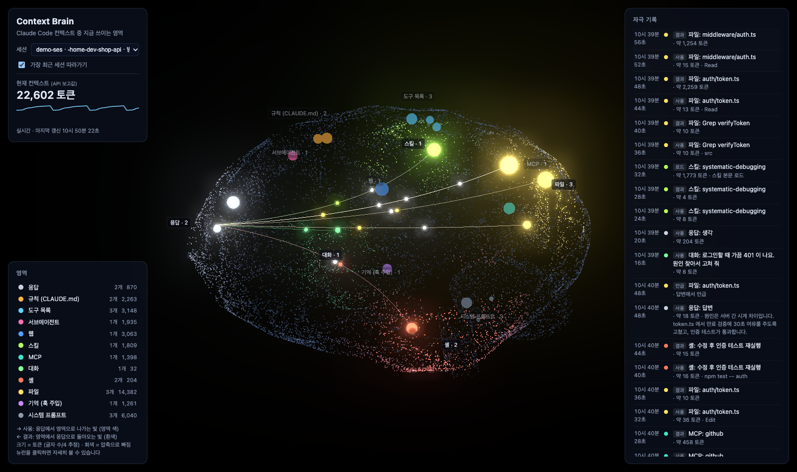
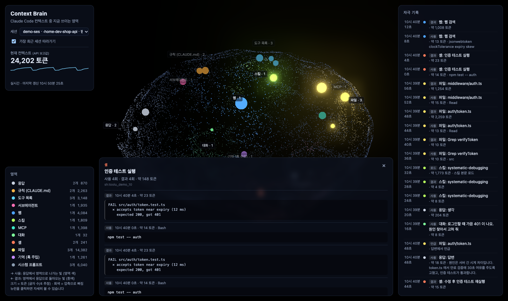

# Context Brain

**Claude Code가 지금 어떤 컨텍스트를 쓰고 있는지 3D 뇌로 보여 주는 로컬 뷰어.**

Claude Code 컨텍스트에는 CLAUDE.md 규칙, 시스템 프롬프트, 스킬 목록, 읽은 파일, 셸 출력, 웹 검색 결과 같은 것들이 쌓입니다. Context Brain은 이 종류마다 뇌 영역을 하나씩 두고, Claude가 그 영역을 쓰는 순간 빛나게 합니다. 터미널 로그만 봐서는 알기 어려운 것들이 한 화면에 보입니다. 어떤 영역이 컨텍스트를 많이 차지하는지, 지금 무엇을 꺼내 오고 있는지, 압축으로 무엇이 빠졌는지입니다.



## 빠른 시작

```bash
git clone https://github.com/workdd/context-brain.git
cd context-brain
npm install
npm start            # http://localhost:7788
```

브라우저를 열어 두고 다른 터미널에서 Claude Code를 쓰면 됩니다. 기본값은 **가장 최근에 수정된 세션을 자동으로 따라가는** 모드입니다. 다른 세션을 보려면 왼쪽 위 목록에서 고르세요.

Claude Code 세션이 없어도 데모로 확인할 수 있습니다.

```bash
npm run demo         # 가짜 세션이 한 단계씩 진행되는 화면
```

- Node.js 18 이상이 필요합니다. 런타임 의존성은 없습니다 (jest는 테스트용)
- three.js는 브라우저에서 CDN(jsdelivr, `three@0.160.0`)으로 불러옵니다
- 포트는 `PORT=8000 npm start`처럼 바꿀 수 있습니다

## 화면 읽는 법

### 뇌 영역

| 영역 | 뇌 위치 | 무엇이 들어오나 |
|---|---|---|
| 응답 | 앞쪽 (전두엽 앞) | Claude의 생각과 답변. 모든 신호의 출발점이자 도착점 |
| 규칙 (CLAUDE.md) | 앞쪽 위 | 실린 CLAUDE.md 파일마다 뉴런 하나 |
| 도구 목록 | 꼭대기 | 스킬 목록, 에이전트 목록, MCP 안내, 지연 로드한 도구 스키마 |
| 서브에이전트 · 웹 | 앞쪽 좌우 | Agent 호출(종류별), WebSearch · WebFetch(호스트별) |
| 스킬 · MCP | 뒤쪽 좌우 | Skill 호출과 스킬 본문 로드, `mcp__서버__도구` 호출(서버별) |
| 대화 · 셸 | 옆 아래 (측두엽) | 사용자 입력과 압축 요약, Bash 명령 (명령 1회 = 뉴런 1개) |
| 파일 | 뒤쪽 (후두엽) | Read, Edit, Write, Grep, Glob |
| 기억 (훅 주입) | 안쪽 | SessionStart 훅 등이 넣은 추가 컨텍스트 |
| 시스템 프롬프트 | 아래 뒤 (뇌간) | 시스템 프롬프트, 환경, 날짜, 모델 정보 |

### 빛과 신호

| 보이는 것 | 뜻 |
|---|---|
| 응답 → 영역으로 가는 **영역 색** 빛 | **사용**. Claude가 도구를 호출함 |
| 영역 → 응답으로 오는 **흰색** 빛 | **결과**. 도구 결과가 컨텍스트로 들어옴 |
| 영역 → 응답 흰색 빛 (도구 호출 없이) | **언급**. 답변 본문에 앞서 다룬 파일 이름이나 스킬 이름이 나옴 |
| 뉴런 크기 | 그 항목이 차지한 토큰 수 (추정) |
| 뇌 표면이 영역 색으로 물듦 | 그 영역이 최근에 쓰였음. 3.5초에 걸쳐 서서히 꺼짐 |
| 전체가 붉게 번쩍이고 일부 뉴런이 회색으로 바뀜 | **압축**. 회색 뉴런은 컨텍스트에서 빠짐. 규칙 · 시스템 · 도구 목록은 다시 실리므로 그대로 둠 |

### 클릭해서 자세히 보기

뉴런을 클릭하거나 오른쪽 기록에서 한 줄을 클릭하면 상세 패널이 열립니다. 셸 뉴런은 실행한 명령 전체와 출력 앞부분을 보여 주고, 파일 뉴런은 읽기 · 수정 이력을 보여 줍니다. 마우스를 올리면 요약이 나옵니다.



### 패널

- **왼쪽 위**: 세션 선택, 현재 컨텍스트 크기(API가 보고한 값)와 변화 그래프
- **왼쪽 아래**: 영역별 뉴런 수와 토큰 합계. 이름을 클릭하면 카메라가 그 영역으로 이동합니다
- **오른쪽**: 자극 기록. 최신 이벤트가 위에 쌓입니다

## 동작 방식

```
~/.claude/projects/<프로젝트>/<세션>.jsonl   Claude Code가 쓰는 세션 로그
        │  0.4초마다 새 줄만 읽음 (lib/tail.js)
        ▼
파서 (lib/parse.js)
  · attachment(instructions, skill_listing …)  → 로드 이벤트
  · assistant tool_use                          → 사용 이벤트
  · user tool_result (tool_use_id로 짝 맞춤)     → 결과 이벤트
  · assistant text 안의 파일·스킬 이름           → 언급 이벤트
  · usage, compact_boundary                     → 컨텍스트 크기, 압축
        │  Server-Sent Events (server.js, 127.0.0.1:7788)
        ▼
브라우저 (public/app.js, three.js)
  · 처음 연결 시 지금까지의 기록을 한 번에 받아 뇌를 채움
  · 이후 새 이벤트마다 뉴런 발광 + 신호선
```

- Claude Code 설정이나 훅을 건드리지 않습니다. 로그 파일을 읽기만 합니다
- 서버는 `127.0.0.1`에만 열립니다. `~/.claude/projects` 밖의 파일은 요청해도 404를 돌려줍니다
- 서브에이전트 내부 작업(사이드체인)과 claude-mem 관찰 세션은 그리지 않습니다

## 읽을 때 주의

- **빛은 attention이 아닙니다.** 실제로 일어난 사용 기록(도구 호출, 결과, 본문 언급)입니다. 모델 내부의 어느 토큰에 주목했는지는 API로 알 수 없습니다. 컨텍스트에 실려 있지만 조용히 따르기만 한 규칙은 빛나지 않습니다.
- **뉴런 토큰은 추정치입니다.** 글자 수를 4로 나눈 값이고, 이미지는 장당 1,600으로 셉니다. 한국어처럼 글자당 토큰이 많은 언어에서는 실제보다 작게 나옵니다. 왼쪽 위 "현재 컨텍스트"만 API가 보고한 실제 값입니다.
- **로그 형식은 공개 규격이 아닙니다.** Claude Code 버전이 바뀌면 일부 항목이 안 잡힐 수 있습니다. 파서는 모르는 항목을 건너뜁니다.

## 개발

```bash
npm test             # jest, lib/ 커버리지 포함
```

| 파일 | 역할 |
|---|---|
| `lib/parse.js` | 로그 한 줄 → 이벤트 변환 (영역 분류, 토큰 추정, 상세 미리보기) |
| `lib/tail.js` | 커지는 파일 따라 읽기 (덜 쓴 줄은 다음 읽기로 넘김) |
| `lib/sessions.js` | 세션 목록, 경로 검사 |
| `server.js` | 정적 파일 + `/api/sessions` + `/api/stream` (SSE) |
| `public/app.js` | 3D 뇌, 뉴런, 신호선, 패널 |
| `scripts/demo.js` | 임시 폴더에 가짜 세션을 만들어 뷰어를 띄움 |

`CLAUDE_PROJECTS_DIR` 환경 변수로 로그 폴더를 바꿀 수 있습니다.

## 라이선스

MIT
