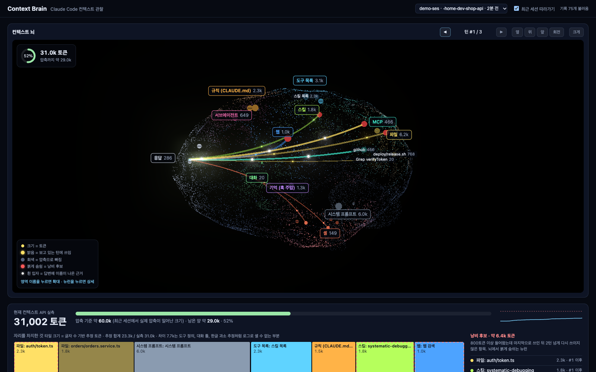

# Context Brain

**Claude Code 세션의 컨텍스트를 3D 뇌로 보여 주는 로컬 뷰어.** 컨텍스트 종류마다 뇌 영역을 하나씩 두고, 컨텍스트에 들어온 항목(읽은 파일, 셸 출력, 규칙, 스킬…)을 뉴런으로 그립니다. 뇌만 보고도 세 가지가 읽히도록 만들었습니다.

| 질문 | 뇌에서 보이는 것 |
|---|---|
| 무엇이 컨텍스트를 차지하고 있나 | 영역 배지의 토큰 합계, 뉴런 크기, 큰 항목의 이름표 |
| 이번 답변은 무엇을 보고 나왔나 | 항목에서 응답 영역으로 이어진 빛줄기 (굵기 = 들어온 토큰). 답변에 이름이 나온 근거는 흰 입자 |
| 무엇이 자리만 차지하고 있나 | 붉게 숨쉬는 뉴런 (낭비 후보) |



## 빠른 시작

```bash
git clone https://github.com/workdd/context-brain.git
cd context-brain
npm install
npm start            # http://localhost:7788
```

브라우저를 열어 두고 다른 터미널에서 Claude Code를 쓰면 됩니다. 기본값은 **가장 최근에 수정된 세션을 자동으로 따라가는** 모드입니다. 다른 세션은 위쪽 목록에서 고릅니다.

Claude Code 세션이 없어도 데모로 확인할 수 있습니다.

```bash
npm run demo                    # 가짜 세션이 한 단계씩 진행됨
node scripts/demo.js --static   # 세 턴을 한 번에 기록하고 멈춤
```

- Node.js 18 이상이 필요합니다. 런타임 의존성은 없습니다 (jest는 테스트용)
- three.js는 브라우저에서 CDN(jsdelivr, `three@0.160.0`)으로 불러옵니다
- 포트는 `PORT=8000 npm start`처럼 바꿀 수 있습니다

## 뇌 읽는 법

### 영역

| 영역 | 뇌 위치 | 무엇이 들어오나 |
|---|---|---|
| 응답 | 앞쪽 | Claude의 생각과 답변. 모든 빛줄기가 모이는 곳 |
| 규칙 (CLAUDE.md) | 앞쪽 위 | 실린 CLAUDE.md 파일마다 뉴런 하나 |
| 도구 목록 | 꼭대기 | 스킬 목록, 에이전트 목록, MCP 안내, 지연 로드한 도구 스키마 |
| 서브에이전트 · 웹 | 앞쪽 좌우 | Agent 호출(종류별), WebSearch · WebFetch(호스트별) |
| 스킬 · MCP | 뒤쪽 좌우 | Skill 호출과 스킬 본문, `mcp__서버__도구` 호출(서버별) |
| 대화 · 셸 | 옆 아래 | 사용자 입력과 압축 요약, Bash 명령 (명령 1회 = 뉴런 1개, 이름은 명령 설명) |
| 파일 | 뒤쪽 | Read, Edit, Write, Grep, Glob |
| 기억 (훅 주입) | 안쪽 | SessionStart 훅 등이 넣은 추가 컨텍스트 |
| 시스템 프롬프트 | 아래 뒤 | 시스템 프롬프트, 환경, 날짜, 모델 정보 |

뇌 표면은 항목이 있는 영역만 그 영역 색으로 옅게 칠해집니다. 영역 배지에는 이름과 지금 컨텍스트에 남은 토큰 합계가 나옵니다.

### 뉴런과 빛

| 보이는 것 | 뜻 |
|---|---|
| 뉴런 크기 | 그 항목이 차지한 토큰 수 (추정) |
| 밝은 뉴런 | 보고 있는 턴에 쓰임. 그 전 두 턴에 쓰인 것은 중간 밝기, 오래된 것은 어둡게 |
| 회색 뉴런 | 압축으로 컨텍스트에서 빠짐 |
| 붉게 숨쉬는 뉴런 | 낭비 후보. 800토큰 이상 들어왔는데 마지막으로 쓰인 뒤 2턴 넘게 다시 쓰이지 않음 |
| 이름표 | 토큰이 큰 상위 8개와 보고 있는 턴의 항목(최대 12개). 겹치면 우선순위가 낮은 쪽을 숨김 |
| 빛줄기 | 보고 있는 턴에 쓰인 항목 → 응답. **굵기 = 결과로 들어온 토큰**. 입자가 계속 흐름 |
| 흰 입자 | 답변 문장에 그 항목 이름이 그대로 나옴 (근거) |
| 순간 반짝임 | 실시간으로 도구 호출(영역 색)과 결과(흰색)가 오갈 때 |
| 전체가 붉게 번쩍임 | 압축이 일어남 |

### 조작

| 조작 | 동작 |
|---|---|
| 영역 배지 클릭 | 카메라가 그 영역으로 다가가고, 오른쪽에 그 영역 항목 목록이 뜸 |
| 뉴런 클릭 | 상세 패널: 실행한 명령이나 수정 내용 전체, 결과 앞부분, 사용 이력, 쓰인 턴 |
| ◀ ▶ (또는 `[` `]` 키) | 보고 있는 턴을 바꿈. 뇌의 밝기와 빛줄기가 그 턴 기준으로 바뀜 |
| 옆 · 위 · 앞 | 시점 이동. 드래그로 돌리고 휠로 확대 |
| 회전 | 자동 회전 켜기/끄기 (기본은 끔) |
| 크게 | 화면 전체로 키움 (Esc로 복귀) |

왼쪽 위 링은 압축 기준 대비 현재 컨텍스트 크기입니다. 압축 기준은 최근 세션에서 실제로 자동 압축이 일어난 직전 크기 중 최댓값입니다.


## 뇌 아래 패널


| 패널 | 내용 |
|---|---|
| 컨텍스트 예산 | 현재 컨텍스트(API 실측), 압축 기준 게이지, 크기 변화 그래프, 항목별 면적 지도, 낭비 후보 목록 |
| 턴 타임라인 | 턴마다 작은 뇌 썸네일, 도구 호출 흐름(실패는 빨간 테두리), 답변 문장별 근거 칩, 늘 실려 있던 컨텍스트. "이 턴을 뇌에서 보기"로 위 뇌를 그 턴으로 바꿈 |

목록 위에 마우스를 올리면 뇌에서 해당 뉴런이 잠깐 밝아집니다.

## 동작 방식

```
~/.claude/projects/<프로젝트>/<세션>.jsonl   Claude Code가 쓰는 세션 로그
        │  0.4초마다 새 줄만 읽음 (lib/tail.js)
        ▼
파서 (lib/parse.js)
  · attachment(instructions, skill_listing …)  → 로드
  · assistant tool_use                          → 사용
  · user tool_result (tool_use_id로 짝 맞춤)     → 결과
  · assistant text                              → 답변 본문 + 언급
  · usage                                       → 컨텍스트 크기 (실측)
  · system turn_duration / compact_boundary     → 턴 종료 / 압축
        │  Server-Sent Events (server.js, 127.0.0.1:7788)
        ▼
브라우저
  · public/model.js  면적 지도 배치, 문장 분리, 근거 연결, 낭비 판정
  · public/app.js    3D 뇌 (three.js), 예산, 타임라인, 상세
```

- Claude Code 설정이나 훅을 건드리지 않습니다. 로그 파일을 읽기만 합니다
- 서버는 `127.0.0.1`에만 열립니다. `~/.claude/projects` 밖의 파일은 요청해도 404를 돌려줍니다
- 서브에이전트 내부 작업(사이드체인)과 claude-mem 관찰 세션은 그리지 않습니다

## 읽을 때 주의

- **빛과 근거는 attention이 아닙니다.** 실제로 일어난 사용 기록(도구 호출, 결과, 답변 본문의 이름 일치)입니다. 이름을 말하지 않고 내용만 쓴 문장은 근거가 없는 것처럼 보입니다.
- **뉴런 토큰은 추정치입니다.** 글자 수를 4로 나눈 값이고, 이미지는 장당 1,600으로 셉니다. 한글처럼 글자당 토큰이 많은 언어는 실제보다 작게 나옵니다. 링과 "현재 컨텍스트"만 API 실측값입니다.
- **압축 기준은 관측값입니다.** 모델이나 설정이 다른 세션의 압축 크기가 섞일 수 있습니다.
- **낭비 후보는 제안입니다.** 다시 쓰이지 않았다는 사실만 봅니다. 규칙처럼 조용히 참고되는 내용은 대상에서 뺐습니다.
- **로그 형식은 공개 규격이 아닙니다.** Claude Code 버전이 바뀌면 일부 항목이 안 잡힐 수 있습니다. 파서는 모르는 항목을 건너뜁니다.

## 개발

```bash
npm test             # jest, lib/ 와 public/model.js 커버리지 포함
```

| 파일 | 역할 |
|---|---|
| `lib/parse.js` | 로그 한 줄 → 이벤트 변환 (영역 분류, 토큰 추정, 상세 미리보기, 답변 본문) |
| `lib/tail.js` | 커지는 파일 따라 읽기 (덜 쓴 줄은 다음 읽기로 넘김) |
| `lib/sessions.js` | 세션 목록, 경로 검사, 관측된 압축 기준 |
| `server.js` | 정적 파일 + `/api/sessions` + `/api/limits` + `/api/stream` (SSE) |
| `public/model.js` | 화면과 무관한 판단 로직 (브라우저와 jest 공용) |
| `public/app.js` | 3D 뇌와 화면 전체 |
| `scripts/demo.js` | 임시 폴더에 가짜 세션을 만들어 뷰어를 띄움 |

`CLAUDE_PROJECTS_DIR` 환경 변수로 로그 폴더를 바꿀 수 있습니다.

## 라이선스

MIT
