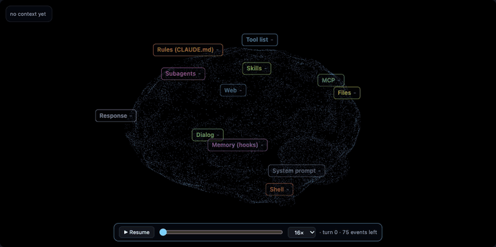
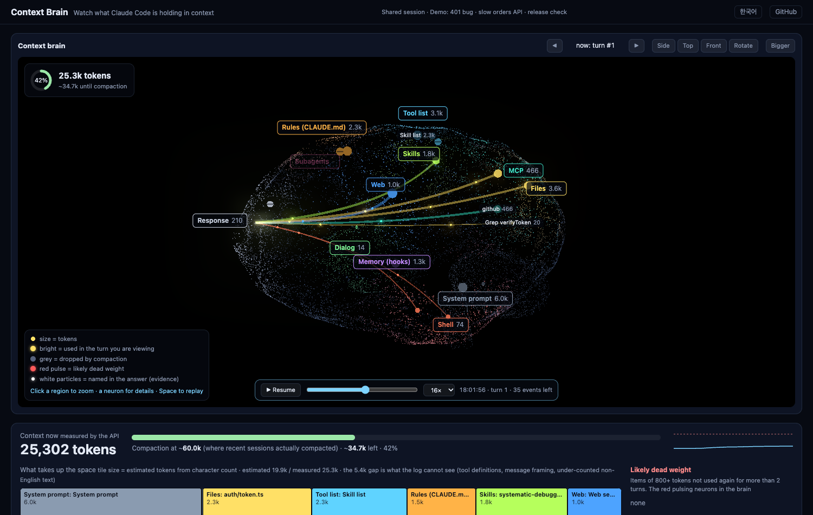

# Context Brain

**See what Claude Code is holding in its head.** Context Brain turns a Claude Code session into a live 3D brain: every file it read, every shell output, rule, skill and tool result becomes a neuron in its own region, and you watch light flow from the context into each answer.

**[▶ Live demo](https://context-brain.pages.dev)** (no install, replays a sample session) · [한국어](README.ko.md)



```bash
npx github:workdd/context-brain
```

That's it. It opens your browser and follows your most recent Claude Code session in real time. Nothing to configure: it only reads the session logs Claude Code already writes.

## What it answers

| Question | Where you see it |
|---|---|
| What is filling my context? | Region badges with token totals, neuron size, name tags on the biggest items |
| What did this answer actually use? | Light beams from items into the Response region (thickness = tokens returned). White particles = the answer names that item |
| What is just taking up space? | Red pulsing neurons: 800+ tokens, not used again for more than 2 turns |
| How close am I to auto-compaction? | The ring in the corner, against the size where your recent sessions actually compacted |
| How did the session unfold? | Replay: scrub through the whole session and watch the brain grow turn by turn |

## Features

- **Live**: tails the session log every 0.4 s and pushes events over Server-Sent Events. Tool calls flash in their region, results flow back in white.
- **Replay**: replay any session from the start at 4×, 16× or 64×, or drag the slider to any point. `Space` plays and pauses.
- **Turn stepping**: `[` and `]` (or ◀ ▶) re-light the brain for a past turn: which items it used, which beams fed the answer.
- **Share as one HTML file**: export a session as a single self-contained HTML that opens without a server and replays itself. Redaction is on by default.
- **Click anything**: a region badge zooms the camera and lists its items. A neuron shows the full command or edit, the start of its output, its use history and the turns it appeared in.
- **Budget panel**: measured context size (from API usage), a compaction gauge, a size sparkline, a treemap of what takes the space, and the dead-weight list.
- **Turn timeline**: per turn, a mini brain, the tool-call flow (failures in red), and each answer sentence with chips for the items it names.
- **English and Korean UI**: follows your browser language. Switch in the header.



## Brain regions

| Region | What lands there |
|---|---|
| Response | Thinking and answers. Every beam ends here |
| Rules (CLAUDE.md) | One neuron per loaded CLAUDE.md |
| Tool list | Skill list, agent list, MCP instructions, deferred tool schemas |
| Subagents · Web | Agent calls (by type), WebSearch and WebFetch (by host) |
| Skills · MCP | Skill calls and skill bodies, `mcp__server__tool` calls (by server) |
| Dialog · Shell | Your prompts and compaction summaries, Bash commands (one neuron per command, named by its description) |
| Files | Read, Edit, Write, Grep, Glob |
| Memory (hooks) | Extra context injected by SessionStart and other hooks |
| System prompt | System prompt, environment, date, model |

## Commands

```bash
npx github:workdd/context-brain                     # viewer on http://localhost:7788, opens the browser
npx github:workdd/context-brain demo                # sample session, no Claude Code needed
npx github:workdd/context-brain export latest --redact -o my-session.html
```

| Option | Meaning |
|---|---|
| `--port <n>` | Port (falls through to the next free one) |
| `--no-open` | Do not open the browser |
| `export [file.jsonl\|latest]` | Save a session as one HTML file that replays itself |
| `--redact` | Leave out tool output previews, commands, prompts and answer text. Home paths always become `~` |

From a clone: `npm install && npm start`. Node.js 18+, no runtime dependencies. three.js loads from a CDN in the browser.

## How it works

```
~/.claude/projects/<project>/<session>.jsonl    written by Claude Code
        │  read new lines every 0.4 s (lib/tail.js)
        ▼
parser (lib/parse.js)
  attachment (instructions, skill_listing …)  → loaded
  assistant tool_use                          → used
  user tool_result (matched by tool_use_id)   → result
  assistant text                              → answer + named items
  usage                                       → context size (measured)
  system turn_duration / compact_boundary     → turn end / compaction
        │  Server-Sent Events (server.js, 127.0.0.1 only)
        ▼
browser: public/app.js (three.js brain, panels, replay) + public/model.js (treemap, evidence, dead weight)
```

- Read-only. It never touches Claude Code settings or hooks.
- The server binds to `127.0.0.1` and refuses any path outside `~/.claude/projects`.
- Subagent sidechains and claude-mem observer sessions are skipped.

## Read it with care

- **Light is not attention.** Beams and evidence come from what actually happened: tool calls, results, and item names appearing in the answer text. A sentence that uses a file without naming it shows no evidence.
- **Neuron tokens are estimates** (characters / 4, images 1,600 each). Non-English text is under-counted. Only the ring and "Context now" are measured by the API.
- **The compaction point is observed**, taken from recent sessions that actually compacted. Sessions on different models or settings can mix.
- **Dead weight is a hint.** It only knows an item was not used again. Rules and other quietly consulted context are excluded.
- **The log format is not a public spec.** A Claude Code update can hide some items. Unknown entries are skipped.

## Development

```bash
npm test             # jest with coverage for lib/ and public/model.js
npm run demo         # sample session that keeps adding steps live
npm run build:web    # build web/index.html (the live demo)
```

`CLAUDE_PROJECTS_DIR` points the viewer at another log folder.

## License

MIT
